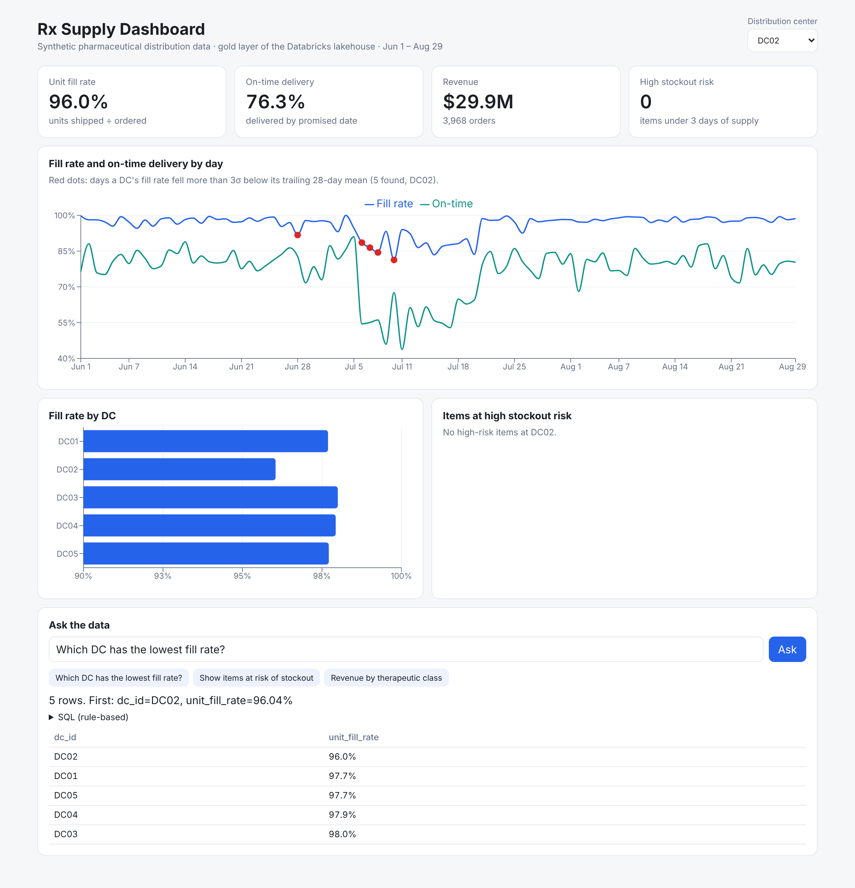

# Rx Supply Lakehouse

[](https://github.com/surendrachallagundla301/rx-supply-lakehouse/actions/workflows/ci.yml)

A full-stack data project for a pharmaceutical distributor: a **Databricks medallion pipeline**
(PySpark, Delta Lake, Unity Catalog) builds a **star schema** from raw order and inventory feeds,
a **FastAPI** service exposes KPIs and an **LLM "ask the data"** endpoint, and a **React +
TypeScript** dashboard shows fill rate, on-time delivery, anomalies and stockout risk. CI/CD runs
in **Azure DevOps** and deploys to Databricks with **Asset Bundles**.

> All data is synthetic: invented products, fake NDCs and numbered customers. The generator
> plants a two-week supply disruption at one distribution center so the analysis has something
> real to find.



## Architecture

```
 raw files (ADLS volume)                   Databricks job (Asset Bundle, daily)
 ─────────────────────                     ─────────────────────────────────────────────────────────
 products.csv              ┌─────────┐    ┌──────────────────────┐    ┌───────────────────────────────┐
 customers.csv        ───▶ │ bronze  │ ─▶ │ silver               │ ─▶ │ gold (star schema)            │
 distribution_centers.csv  │ as-is + │    │ typed, de-duplicated │    │ dim_date  dim_product         │
 inventory_snapshots.csv   │ lineage │    │ validated; bad rows  │    │ dim_customer  dim_dc          │
 order_lines.jsonl (API)   └─────────┘    │ → quarantine + reason│    │ fact_order_line               │
                                          └──────────────────────┘    │ agg_daily_kpis                │
                                                                      │ agg_stockout_risk             │
                                                                      └──────────────┬────────────────┘
                                                      quality gates (PK, FK, ranges) │ fail the job
                                                                                     ▼
                     React + TS dashboard  ◀── /api ──  FastAPI  ── SQL ──▶ Databricks SQL warehouse
                     (Vite, Recharts)                   │                   (DuckDB over Parquet locally)
                                                        └── /api/ask ──▶ Azure OpenAI → SQL guard → query
```

## What's in it

| Area | Where | Notes |
|---|---|---|
| Ingestion (bronze) | `src/rx_lakehouse/bronze.py` | Explicit schema for the JSON feed; `_ingested_at` and `_source_file` lineage columns |
| Cleaning (silver) | `silver.py` | Dedupe by business key (latest ingest wins), `try_cast` parsing, six validation rules. Failing rows go to `order_lines_quarantine` with **every** rule they broke |
| Modeling (gold) | `gold.py` | Star schema with stable `xxhash64` surrogate keys; daily KPI and days-of-supply tables |
| Data quality | `quality.py` | Unique keys, no orphan facts, rate ranges, quarantine ratio ≤ 2%. A failure stops the job before dashboards refresh |
| Orchestration | `databricks.yml`, `resources/job.yml` | Bronze → silver → gold → quality as four wheel tasks; dev and prod targets; schedule paused outside prod |
| CI/CD | `azure-pipelines.yml`, `.azure/` | Lint, PySpark tests, React tests and build, wheel artifact; deploy to dev with a smoke run, then prod behind an environment approval |
| API | `api/` | KPI, trend, by-DC, anomaly (z-score vs trailing 28 days) and stockout endpoints; one structured log event per request with latency |
| LLM feature | `api/ask.py`, `api/sql_guard.py` | Model writes SQL as JSON → guard parses it with sqlglot, allows one `SELECT` on gold tables only, blocks file-reading functions, forces a row limit → answer grounded in the returned rows. Temperature 0, 400-token cap, token usage logged; falls back to rule-based intents if the model is unavailable or its SQL is rejected |
| Front end | `web/` | React 18 + TypeScript + Recharts; DC filter, KPI tiles, anomaly markers, risk table, ask panel |
| Analysis | `notebooks/01_supply_analysis.py` | Databricks notebook answering three operations questions (below) |
| BI | `sql/dashboard.sql` | Datasets for a Databricks AI/BI dashboard or Power BI |

## Findings (from the notebook)

1. **DC02's lower fill rate is one event, not a trend.** Over the whole period DC02 fills 96.0% of
   units vs. 97.7–98.0% elsewhere, but almost all of the gap comes from July 6–20, when fill rate fell
   to 87.0% and on-time delivery to 57.0% (97.8% and 80.6% the rest of the time). The anomaly rule
   flags 5 days in that window. Monthly averages would have hidden it, so the dashboard alerts daily.
2. **Revenue is concentrated in cold-chain specialty drugs.** Oncology and Immunology are 25% of SKUs
   but 84% of revenue. The top 20% of products are 69% of units. The stockout watchlist in
   `sql/dashboard.sql` therefore ranks by cost at risk, not units.
3. **Customer type doesn't explain service problems.** On-time delivery is 78.0–78.6% for hospitals,
   clinics, retail and specialty pharmacies alike. The problem was location, not segment.

## Run it locally

Requires Python 3.10+, Java 17+ (for PySpark) and Node 20+.

```bash
pip install -e ".[local,api,dev]"
python -m rx_lakehouse.generate --out data/raw --days 90       # ~61k order lines, ~1.5% planted defects
python -m rx_lakehouse.pipeline --layer all                     # bronze → silver → gold → quality gates
pytest -q                                                       # 22 tests: Spark transforms, end-to-end pipeline, API, SQL guard

uvicorn api.main:app --port 8000                                # API
cd web && npm install && npm run dev                            # dashboard on http://localhost:5173
```

Locally the pipeline writes Parquet because the Delta Lake jars aren't bundled with the PySpark wheel.
On Databricks (`DATABRICKS_RUNTIME_VERSION` is set) it writes Delta tables to
`<catalog>.supply.<layer>_<table>`. The API switches to a Databricks SQL warehouse when
`DATABRICKS_HOST`, `DATABRICKS_HTTP_PATH` and `DATABRICKS_TOKEN` are set, and uses Azure OpenAI when
`AZURE_OPENAI_ENDPOINT`, `AZURE_OPENAI_API_KEY` and `AZURE_OPENAI_DEPLOYMENT` are set.

## Deploy to Azure

1. Create a Unity Catalog volume for raw files and upload `data/raw/*`.
2. Put your workspace URL in `databricks.yml`, then `databricks bundle deploy -t dev`.
3. In Azure DevOps, create variable groups `rx-lakehouse-dev` and `rx-lakehouse-prod` (service-principal
   credentials) and a `prod` environment with an approval check, then point a pipeline at
   `azure-pipelines.yml`.
4. Build the `Dockerfile` (API + built React app) and run it on Azure App Service or Container Apps.

## Pipeline output (90-day run)

| Layer | Rows |
|---|---|
| bronze order lines | 60,970 |
| silver order lines (after dedupe and validation) | 59,746 |
| quarantined (malformed NDC 149, unknown customer 100, non-positive qty 74) | 323 |
| gold fact_order_line | 59,746 |
| quality gates passed | 8 / 8 |
